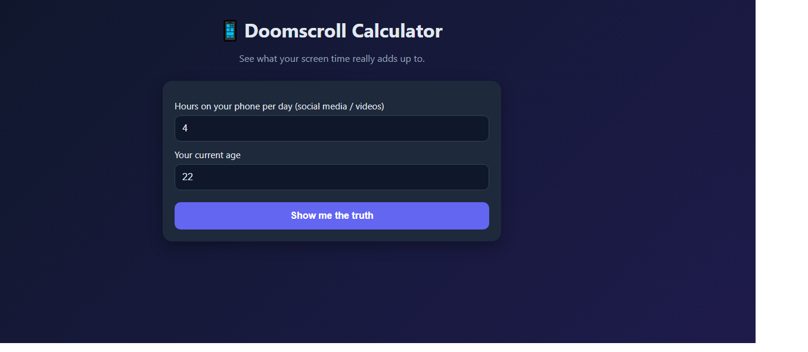
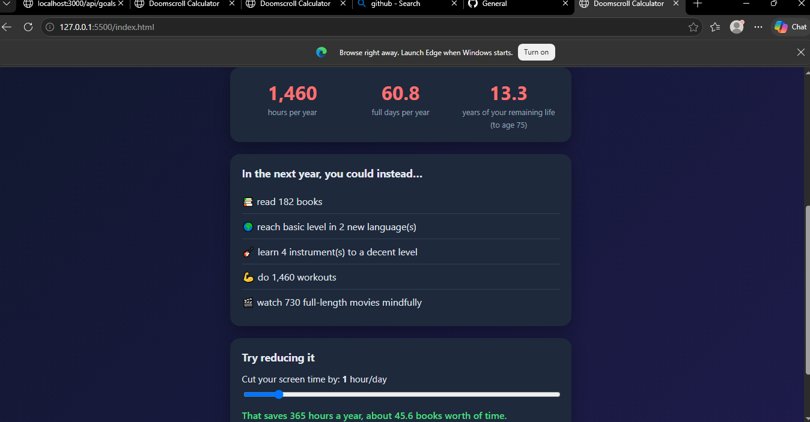

# Doomscroll Calculator

A full-stack web app that shows how much of your life goes into phone scrolling, and what you could do with that time instead.




## Features
- Enter your daily phone hours and age to see hours per year, days per year, and years of your remaining life.
- Shows what you could do with that time (books, languages, workouts, and more).
- A slider shows how much time you win back by cutting screen time.
- Goals are loaded from a MySQL database.
- Every calculation is saved to the database.

## Tech stack
- **Frontend:** HTML, CSS, JavaScript
- **Backend:** Node.js, Express
- **Database:** MySQL

## How to run

**Requirements:** Node.js and MySQL installed.

1. Create the database: run `schema_mysql.sql` in MySQL Workbench.
2. In the `backend` folder, copy `.env.example` to `.env` and add your MySQL password.
3. Install and start the backend:
```
   cd backend
   npm install
   npm start
```
4. Open `index.html` with the VS Code Live Server extension.

## API endpoints
| Method | Route | What it does |
|--------|-------|--------------|
| GET | /api/health | Checks the database connection |
| GET | /api/goals | Returns the list of goals |
| POST | /api/calculations | Validates and saves a result |
| GET | /api/calculations | Returns the latest 20 results |

## What I learned
- Building a REST API with Express and connecting it to MySQL
- Validating input on the server
- Keeping secrets out of GitHub with `.env` and `.gitignore`

## Future improvements
- Show saved history on the page
- User login
- Deploy online

## Author
[Arun Kumar J] - [arunkumarj9633@gmail.com]